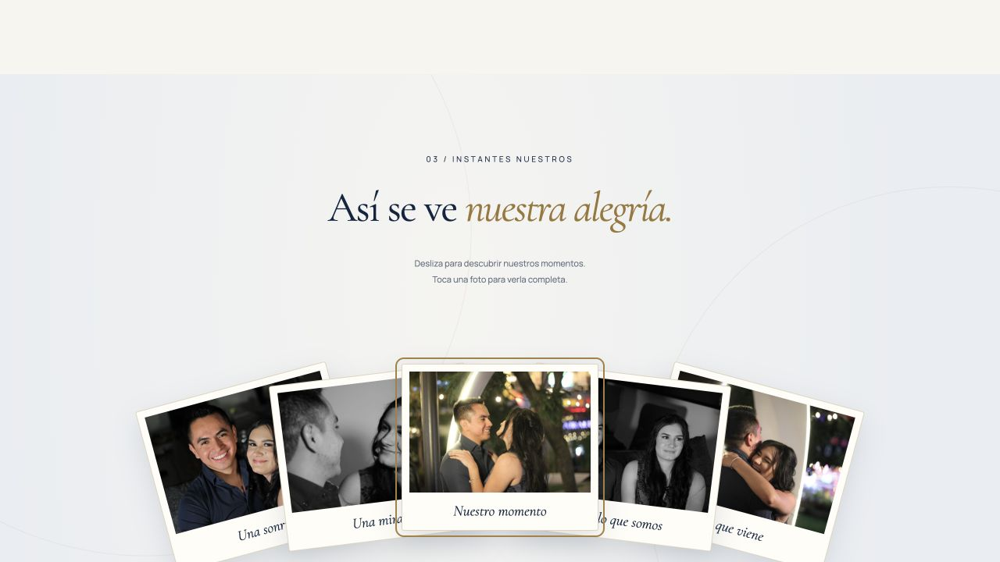
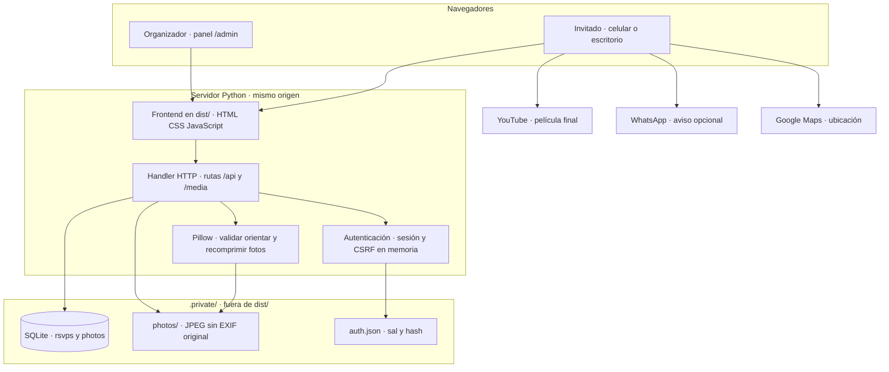
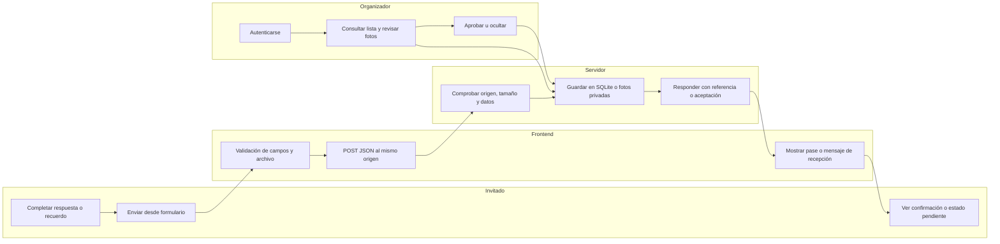
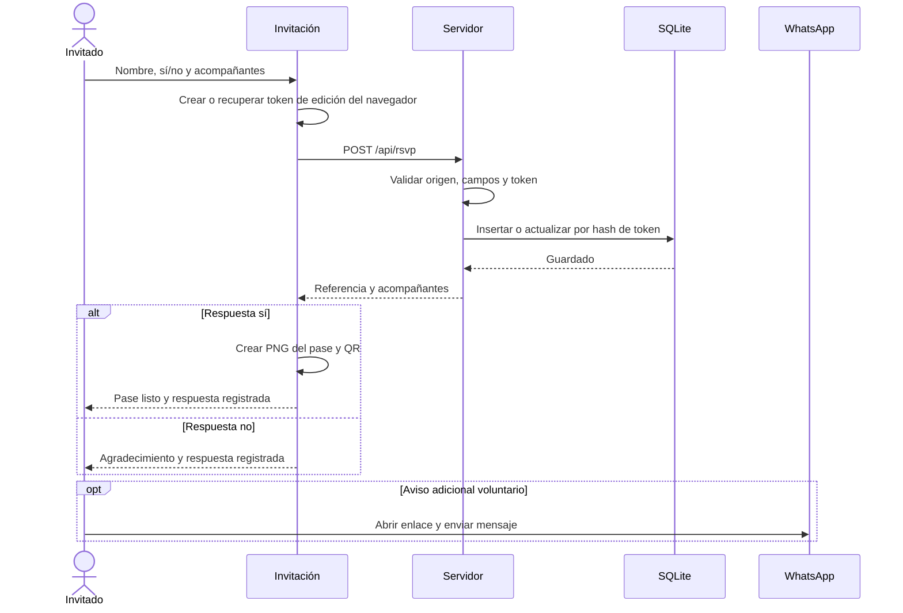
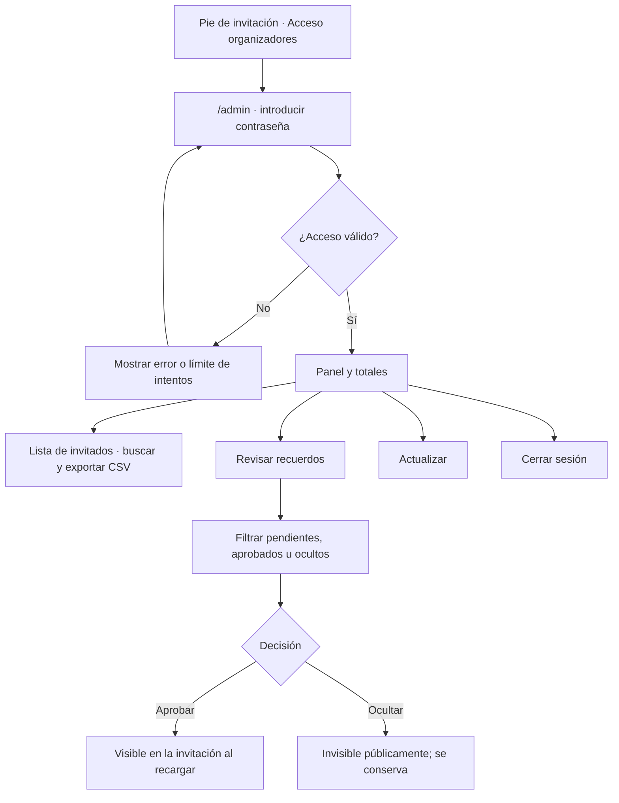
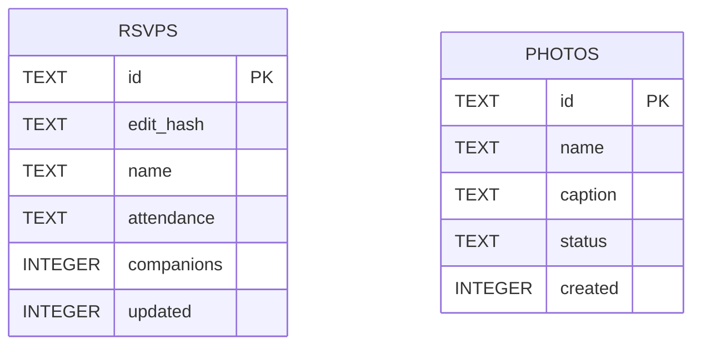

# Karina & Alexis · Invitación cinematográfica de boda

Invitación digital de **Karina Querén Vázquez Ledezma** y **Alexis Eduardo Hernández Mejía**, diseñada y producida por **Vector Inside**. Reúne una película de su historia, la información de la celebración, fotografías, confirmación de asistencia con acompañantes y un álbum de recuerdos que los organizadores moderan antes de publicarlo.

**Entrega de desarrollo: versión V11, 3 de noviembre de 2026.** La aplicación fue revisada localmente. Este repositorio entrega código y recursos; cargarlo en GitHub no publica por sí mismo el servicio de la boda.



## Índice

1. [Datos de la boda](#datos-de-la-boda)
2. [Qué incluye y qué falta](#qué-incluye-y-qué-falta)
3. [Descargar e instalar](#descargar-e-instalar)
4. [Acceso de organizadores y contraseña](#acceso-de-organizadores-y-contraseña)
5. [Arquitectura](#arquitectura)
6. [Estructura de archivos](#estructura-de-archivos)
7. [Dependencias](#dependencias)
8. [Recorrido de invitados](#recorrido-de-invitados)
9. [Recorrido de organizadores](#recorrido-de-organizadores)
10. [Modelo de datos y API](#modelo-de-datos-y-api)
11. [Decisiones de diseño y desarrollo](#decisiones-de-diseño-y-desarrollo)
12. [Video, fotos y recursos](#video-fotos-y-recursos)
13. [Pruebas](#pruebas)
14. [Publicación y operación](#publicación-y-operación)
15. [Continuar el desarrollo](#continuar-el-desarrollo)
16. [Problemas frecuentes](#problemas-frecuentes)
17. [Créditos y derechos](#créditos-y-derechos)

## Datos de la boda

| Dato | Confirmado para esta entrega |
| --- | --- |
| Novia | Karina Querén Vázquez Ledezma |
| Novio | Alexis Eduardo Hernández Mejía |
| Fecha | 21 de noviembre de 2026 |
| Recepción | 1:00 p. m. |
| Ceremonia | 2:00 p. m. |
| Sede para ambas | Salón de eventos de Residencial Alboreto |
| Dirección | Calle Ali Chumacero 1000, San Lorenzo Coacalco, CP 52140, Metepec, Estado de México |
| Vestimenta | Formal; hombres, evitar azul marino |
| WhatsApp de contacto | +52 722 647 81 30 |
| Película final | [ALEXIS Y KARII en YouTube](https://youtu.be/X3-ZLqJwMeo), 5:23 |
| Mapa | [Ficha de Alboreto Residencial](https://www.google.com/maps/search/?api=1&query=Alboreto%20Residencial&query_place_id=ChIJq13C7TKLzYURUTEebuCBcDM) |

El mapa apunta a la ficha del **residencial**; no se afirmó haber localizado un punto independiente del salón dentro del conjunto. No se inventó el tipo religioso o civil de la ceremonia. Los nombres cortos “Karina & Alexis” se conservan en portada y firmas; la presentación formal incluye los nombres completos con acentos.

## Qué incluye y qué falta

### Implementado

- Diseño adaptable a celular, tableta y escritorio, azul marino, dorado y marfil.
- Película de YouTube que se carga después de una acción voluntaria y de un aviso para usar audífonos y girar el celular.
- Portada, historia, nombres, fecha, recepción, ceremonia, vestimenta y acceso al mapa.
- Galería original de 12 fotografías seleccionadas, con desplazamiento horizontal y visor ampliado.
- Abanico introductorio de cinco fotos que abre las imágenes del mismo álbum.
- Apariciones suaves y movimiento ligero de las imágenes grandes, con respeto a la preferencia de reducir movimiento.
- Registro persistente de asistencia y número de acompañantes.
- Pase descargable como PNG con nombre, referencia y QR; aviso opcional por WhatsApp.
- Subida de foto y frase, consentimiento de publicación y revisión previa.
- Panel privado: totales, lista, búsqueda, exportación CSV y moderación reversible de recuerdos.
- Pruebas del servidor y verificación de recursos del frontend.

### Límites reales de esta versión

- El servidor incluido está ligado a `127.0.0.1`: es una implementación de revisión local, no un despliegue público listo para recibir invitados externos.
- No hay lista nominal precargada ni cupos individuales por invitación. El invitado declara acompañantes; el formulario no concede pases adicionales.
- El token guardado en el navegador permite actualizar la misma respuesta. Otro navegador/dispositivo puede producir un registro duplicado. No se deduplican personas solo por su nombre.
- No se importaron respuestas históricas de WhatsApp. Los totales solo cuentan respuestas guardadas por esta aplicación.
- El QR contiene información del pase; no es una firma criptográfica ni un sistema automático de validación o bloqueo de entradas repetidas. Recepción coteja la referencia en la lista del panel.
- El panel comparte una contraseña y no tiene roles separados, cuentas personales, 2FA ni bitácora de quién aprobó cada foto.
- Las sesiones, el límite de intentos de acceso y el control de frecuencia de fotos viven en memoria y se reinician con el proceso.
- El álbum carga las fotos aprobadas al abrir/recargar la página. El panel usa “Actualizar”; no hay sincronización en tiempo real.
- Se observó “video no disponible” en el iframe del navegador de prueba, aunque la página directa de YouTube sí permitió reproducirlo. Debe verificarse en el dominio final. El acceso directo a YouTube permanece disponible.

## Descargar e instalar

### Opción A · Clonar con Git

```bash
git clone https://github.com/VectorInside/INVITACION-DE-BODA-KARI-Y-ALEXIS.git
cd INVITACION-DE-BODA-KARI-Y-ALEXIS
```

Para obtener cambios posteriores, con el trabajo propio ya guardado:

```bash
git pull --ff-only
```

Para proponer adecuaciones, crear una rama y abrir un pull request. No usar `--force` para sobrescribir trabajo del equipo.

### Opción B · Descargar ZIP

En GitHub, seleccionar **Code → Download ZIP**, descomprimir y abrir la carpeta del proyecto. No abrir `index.html` directamente con doble clic: las confirmaciones, sesiones y fotos necesitan las rutas HTTP del servidor.

### Requisitos del equipo

- Python 3.9 o posterior. Las pruebas automatizadas del repositorio usan Python 3.11.
- `pip` y soporte de entornos virtuales.
- Navegador actualizado.
- Git, si se trabaja por ramas.
- Node.js solo para la revisión opcional de sintaxis JavaScript. No se necesita Node para servir la invitación.

### macOS y Linux

```bash
python3 -m venv .venv
source .venv/bin/activate
python -m pip install -r requirements.txt
python tools/configure_admin.py
python server.py
```

Cuando el configurador pida la contraseña, introducir la indicada en la sección de acceso de organizadores y repetirla. La entrada no se muestra al escribir. Esto configura el acceso **en esa copia local** sin descargar datos de invitados de otra computadora.

### Windows · PowerShell

```powershell
py -m venv .venv
.\.venv\Scripts\Activate.ps1
python -m pip install -r requirements.txt
python tools\configure_admin.py
python server.py
```

Si la política del equipo impide activar el entorno, pueden ejecutar directamente su intérprete sin cambiar políticas globales:

```powershell
.\.venv\Scripts\python.exe -m pip install -r requirements.txt
.\.venv\Scripts\python.exe tools\configure_admin.py
.\.venv\Scripts\python.exe server.py
```

### Abrir y detener

- Invitación: **http://127.0.0.1:8741/**
- Organizador: **http://127.0.0.1:8741/admin**
- Detener: `Ctrl+C` en la terminal del servidor.
- Mantener esa terminal/proceso activo durante las pruebas: al cerrarlo, el navegador mostrará que no puede acceder al sitio.

Puerto alternativo:

```bash
python tools/configure_admin.py --port 8750
python server.py --port 8750
```

El puerto del configurador solo ajusta el enlace del archivo local de acceso; el servidor escucha en el puerto de su propio argumento. En ambos casos el enlace de `/admin` de la página se resuelve en el origen actual.

Directorio persistente alternativo:

```bash
python tools/configure_admin.py --data-dir /ruta/privada/datos-boda
python server.py --data-dir /ruta/privada/datos-boda
```

Pasar la misma carpeta a ambos comandos. Nunca colocar los datos dentro de `dist/`.

## Acceso de organizadores y contraseña

El acceso al que se llamó “puerta trasera” durante el diseño es el **panel administrativo normal** de la aplicación. No salta la autenticación ni ofrece una ruta secreta para evitarla.

| Elemento | Valor |
| --- | --- |
| Ruta | `/admin` |
| Entrada desde la invitación | Enlace discreto “Acceso organizadores ↗” al pie |
| Usuario | No se pide nombre de usuario |
| Contraseña acordada para este evento | **`eduardo&queren`** |
| Vigencia de una sesión | 8 horas, o hasta cierre de sesión/reinicio del proceso |

**La contraseña se documenta aquí por solicitud expresa del responsable del proyecto. Este repositorio es público: por tanto, no debe considerarse un secreto y cualquiera que lea este README puede conocerla.** Ocultar visualmente el enlace no restringe el acceso. El responsable solicitó mantener esta contraseña para el evento; no se implementó cambio ni caducidad automática después de la boda.

El archivo del servidor **no tiene esa contraseña escrita como un bypass**. En cada instalación:

1. Instalar la dependencia de Python.
2. Ejecutar `python tools/configure_admin.py`.
3. Escribir y repetir la contraseña acordada.
4. Iniciar o reiniciar `python server.py`.
5. Abrir `/admin`, introducir la contraseña y entrar.

Si se ejecuta el servidor por primera vez sin configurar acceso, genera una contraseña aleatoria. Puede consultarse en `.private/ACCESO-PRIVADO.txt`, o sustituirse por la acordada ejecutando el configurador y reiniciando el servidor. La existencia del texto en este README no cambia por sí misma el hash de una instalación previa.

### Qué puede hacer el organizador

- Ver cuántas respuestas positivas se guardaron.
- Ver acompañantes declarados y sumar el total previsto de personas.
- Consultar respuestas negativas.
- Buscar invitados por nombre o referencia.
- Descargar una lista CSV.
- Ver fotos pendientes, aprobadas y ocultas.
- Aprobar una foto para hacerla visible en la invitación.
- Ocultar una foto sin borrarla, incluso después de haberla aprobado.
- Cerrar la sesión.

No hay un botón para borrar todas las fotos ni para eliminar permanentemente invitados en esta entrega.

### Cómo se protege técnicamente

- La contraseña se verifica con **PBKDF2-HMAC-SHA256, 300 000 iteraciones y sal aleatoria**.
- El hash y la sal quedan en `.private/auth.json`, fuera de la carpeta web.
- Se intenta restringir a `0700` la carpeta privada al crearla y a `0600` los archivos de acceso en sistemas compatibles; los permisos efectivos en Windows deben revisarse con su administrador.
- La sesión se identifica con un token aleatorio en una cookie `HttpOnly`, `SameSite=Strict`, con `Max-Age` de 8 horas. Añade `Secure` cuando el origen de la solicitud es HTTPS.
- La consulta de invitados y las fotos pendientes necesitan sesión válida en el servidor.
- Moderar y cerrar sesión requieren además un token CSRF vinculado a esa sesión.
- Las peticiones POST requieren JSON y un encabezado `Origin` con el mismo `Host`; no se habilitó CORS abierto.
- Tras seis intentos fallidos de acceso desde una IP en 15 minutos, se devuelve un límite temporal.
- El servidor no registra en sus logs cuerpos de solicitudes, nombres ni contraseñas.

Estas medidas describen la implementación, pero **no compensan la publicación deliberada de la contraseña**. Antes de habilitar acceso externo, el equipo debe acordar con el responsable si el panel requiere una restricción adicional de acceso. No se agregó una restricción externa ni se cambió la contraseña en esta entrega.

## Arquitectura

La aplicación usa un frontend estático sin proceso de compilación, servido por un proceso Python que también atiende las rutas de datos. SQLite conserva registros y un directorio privado conserva imágenes optimizadas. El video final permanece en YouTube.



### Carriles de responsabilidad



### Arquitectura actual frente al despliegue pendiente

| Actual y comprobado localmente | Para habilitar invitados externos |
| --- | --- |
| Proceso Python ligado a loopback | Servicio público detrás de HTTPS y un servidor/proxy apropiado |
| Archivos y SQLite en disco local | Disco persistente y política de respaldos |
| Una instancia del servidor | Mantener una instancia o rediseñar sesiones y base de datos para escalar |
| Recursos estáticos y API en el mismo origen | Conservar el origen o adaptar explícitamente las validaciones |
| Revisión en navegador con tamaños de celular | Probar enlace real desde WhatsApp en iPhone y Android |

No hay Supabase, Firebase, D1, R2, Docker ni un proveedor cloud preconfigurado. El diagrama anterior describe el código existente, no servicios supuestamente conectados.

## Estructura de archivos

```text
.
├── README.md                      # Guía completa para el equipo
├── requirements.txt               # Dependencia Python fijada
├── server.py                      # HTTP, autenticación, RSVP, fotos y SQLite
├── test_server.py                 # Pruebas reales contra servidor temporal
├── .gitignore                     # Excluye datos, entornos y cachés
├── .github/workflows/checks.yml    # Verificación en GitHub Actions
├── tools/
│   ├── configure_admin.py         # Configuración local de contraseña
│   └── check_project.py           # Recursos HTML y sintaxis JS
├── docs/
│   ├── API.md                     # Contratos y ejemplos de peticiones
│   ├── DECISIONES.md              # Decisiones, alternativas y límites
│   ├── ENTREGA-EQUIPO.md          # Ruta sugerida para últimas adecuaciones
│   ├── INVENTARIO-ARCHIVOS.md      # Inventario de archivos entregados
│   └── screenshots/               # Capturas de revisión, sin conversaciones
└── dist/                          # Única raíz de contenido público
    ├── index.html                 # Invitación y diálogos
    ├── style.css                  # Diseño base y adaptaciones móviles
    ├── app.js                     # Video, galería, confirmación y pase
    ├── memories.js                # Envío y consulta de recuerdos
    ├── motion.css                 # Abanico y efectos visuales
    ├── motion.js                  # Observadores y movimiento al recorrer
    ├── admin.html                 # Entrada y estructura del panel
    ├── admin.css                  # Diseño del panel
    ├── admin.js                   # Sesión, totales, CSV y moderación
    └── assets/
        ├── brand/                 # Logos y variantes conservadas
        ├── fonts/                 # Tipografías locales y licencias
        ├── gallery/               # 12 fotos: pequeña y completa
        ├── vendor/                # QRCode y licencia MIT
        ├── *.jpg                  # Portada e imágenes de historia
        └── *.mp4, *.vtt            # Cortes preliminares locales conservados
```

Se conserva el directorio `dist/` completo de la entrega local, incluidos algunos recursos de versiones anteriores. La película actual se toma de YouTube; los MP4 preliminares no están enlazados como película principal. [Inventario detallado](docs/INVENTARIO-ARCHIVOS.md).

No se suben la carpeta `.private/`, bases de datos de invitados, fotos recibidas, archivos de acceso locales, grabaciones de WhatsApp, entrevistas originales ni bibliotecas personales de video. Son material operativo o privado, no dependencias necesarias para ejecutar esta entrega. El video final de alta calidad se entrega mediante su enlace de YouTube, no duplicado en Git.

## Dependencias

| Componente | Uso | Instalación |
| --- | --- | --- |
| Python 3.9+ | Servidor HTTP y lógica | Instalación del equipo |
| Pillow 11.3.0 | Lectura, orientación, validación y conversión de fotos | `pip install -r requirements.txt` |
| sqlite3 | Registros locales persistentes | Biblioteca estándar de Python |
| http.server / http.cookies | Rutas HTTP, contenido estático y cookie | Biblioteca estándar de Python |
| hashlib / hmac / secrets | Hash y comparación de contraseña, referencias y tokens | Biblioteca estándar de Python |
| QRCode vendorizado | Generar QR en canvas para el pase | Ya incluido en `dist/assets/vendor/` |
| Cormorant Garamond | Tipografía editorial | Archivos locales en `assets/fonts/` |
| Manrope | Texto, botones y datos prácticos | Archivos locales en `assets/fonts/` |
| Navegador con dialog, canvas, fetch, Web Crypto e IntersectionObserver | Interacción del frontend | Sin instalación adicional del sitio |
| Node.js | Solo `node --check` en comprobaciones | Opcional local, usado por CI |

No hay `npm install`, bundle, transpiler ni servidor de Vite. El nombre `dist` identifica la carpeta pública mantenida directamente, no un resultado que deba regenerarse con un build.

YouTube, Google Maps y WhatsApp son enlaces/reproductor del navegador. No hay API key de esos servicios en el proyecto ni integración con sus bandejas de mensajes.

## Recorrido de invitados

### 1. Abrir la invitación

La portada presenta los nombres cortos y un botón de película. Es posible recorrer fecha, dirección y confirmación sin ver el video.

### 2. Ver la historia

Al pulsar la película aparece una recomendación de usar audífonos y girar el celular. “Listo, ver nuestra historia” abre el reproductor y establece el `src` del iframe. Al cerrar el diálogo se retira ese `src` para detener la reproducción. El giro no se fuerza mediante una API del sistema, y la calidad se administra en YouTube; no se promete 1080p obligatorio para todos los visitantes.

### 3. Explorar fotos

Cinco fotografías se abren en abanico cuando entran en pantalla. Se pueden tocar para abrir el visor. Después aparece el carrete completo de 12 fotos con desplazamiento táctil, botones y contador. El visor permite avanzar, retroceder y cerrar.

### 4. Confirmar



El invitado queda registrado cuando el servidor acepta la respuesta. No depende de que envíe WhatsApp. “Usar otro nombre” elimina los identificadores locales del navegador para iniciar una respuesta diferente; no borra el registro que ya quedó en el servidor.

La opción de no asistir tiene un desplazamiento lúdico una sola vez para interacciones de puntero. Después permite responder no; con teclado o reducción de movimiento no se aplica ese juego. No bloquea permanentemente una respuesta negativa.

### 5. Compartir un recuerdo

```mermaid
sequenceDiagram
    actor Invitado
    participant Pagina as Formulario de recuerdos
    participant API as Servidor
    participant Fotos as Almacenamiento privado
    actor Organizador
    participant Album as Álbum público
    Invitado->>Pagina: Foto, nombre, frase y consentimiento
    Pagina->>API: POST /api/photos
    API->>API: Validar formato, tamaño y dimensiones
    API->>Fotos: JPEG optimizado y registro pending
    API-->>Invitado: Recibido; pendiente de revisión
    Organizador->>API: Sesión + CSRF + aprobación
    API->>Fotos: Estado approved
    Album->>API: GET /api/photos
    API-->>Album: Solo fotos aprobadas
```

Límites: nombre hasta 80 caracteres, frase hasta 240 y archivo hasta 8 MB; JPG, PNG o WebP. No se admite HEIC en esta entrega. La fotografía se reorienta con EXIF, se convierte a RGB, se reduce a un máximo de 1800 × 1800 y se guarda en JPEG, calidad 85. El JPEG nuevo no conserva el EXIF original. No se modifica la foto original del invitado.

El servidor permite hasta 20 envíos de fotos por IP durante una hora. En una boda, varias personas pueden compartir la IP de una misma red Wi-Fi; el equipo debe revisar este límite antes de operar el álbum durante el evento.

## Recorrido de organizadores



### Cómo se calculan los números

- **Confirmaciones sí**: número de registros con `attendance = yes`, no suma de personas físicas.
- **Acompañantes**: suma de `companions` de esos registros positivos.
- **Total previsto**: confirmaciones positivas + acompañantes declarados.
- **Fotos por revisar**: registros con `status = pending`.
- **No asistirán**: número de registros con respuesta no.

Ejemplo: tres respuestas positivas con 0, 2 y 1 acompañantes producen 3 confirmaciones, 3 acompañantes y un total previsto de 6 personas. No se divide automáticamente por mesas ni se asignan asientos.

## Modelo de datos y API

### Persistencia local

```text
.private/
├── auth.json                  # Sal y hash del acceso
├── ACCESO-PRIVADO.txt          # Recordatorio de acceso, no servido por HTTP
├── wedding.sqlite3            # Base de datos
└── photos/
    └── <id-aleatorio>.jpg      # Copias optimizadas de los recuerdos
```



No hay relación obligatoria entre `rsvps` y `photos`: compartir una foto no exige haber confirmado primero. La tabla `photos` almacena metadatos; el binario está en disco. Las fechas se guardan como segundos Unix.

### Rutas

| Método | Ruta | Acceso | Función |
| --- | --- | --- | --- |
| GET | `/` | Público | Invitación |
| GET | `/admin` o `/admin/` | Página de entrada pública | Entrega pantalla; los datos requieren autenticación |
| GET | `/api/photos` | Público | Hasta 150 fotos aprobadas, recientes primero |
| POST | `/api/photos` | Mismo origen | Recibir recuerdo pendiente |
| GET | `/media/<id>.jpg` | Aprobado: público; resto: sesión | Entregar imagen permitida |
| POST | `/api/rsvp` | Mismo origen | Guardar respuesta |
| GET | `/api/admin/session` | Según cookie | Saber si hay sesión y obtener su CSRF |
| POST | `/api/admin/login` | Mismo origen | Verificar contraseña y crear sesión |
| GET | `/api/admin/dashboard` | Sesión | Invitados, fotos y totales |
| POST | `/api/admin/moderate` | Sesión + CSRF | Aprobar u ocultar foto |
| POST | `/api/admin/logout` | Sesión + CSRF | Invalidar sesión |

Los contratos completos y ejemplos están en [docs/API.md](docs/API.md). Las rutas mutables no aceptan formularios HTML genéricos ni CORS de cualquier dominio.

## Decisiones de diseño y desarrollo

### Una invitación con ritmo de película

La portada invita a escuchar la historia real de la pareja. El video es voluntario y la información práctica sigue disponible. Se evitó una pantalla que obligue a terminar la película para confirmar.

### Identidad de la pareja y firma del estudio

Azul `#102642`, dorado `#cfb174` y marfil `#f8f5ee`. Cormorant Garamond aporta carácter editorial y Manrope facilita lectura de horarios, campos y botones. La restricción de azul marino corresponde a la vestimenta de los hombres; no se interpretó como prohibición del color en el diseño de la web.

El logo auténtico de Vector Inside se suministró en una carpeta de marca. La variante actual es blanca, transparente y pequeña sobre el pie azul. Se cambió el nombre del PNG usado por HTML para evitar la versión de fondo negro que algunos navegadores conservaban en caché. No se dibujó un logo sustituto.

### Movimiento inspirado, adaptado a la boda

La grabación de referencia del usuario mostraba el sitio de Lando Norris: capas de fotos, profundidad y abanico. Se tomaron esas ideas de interacción con fotografías de la pareja, bordes de recuerdo impreso y movimientos contenidos. No se copiaron código, fotografías ni marca del sitio de referencia.

`IntersectionObserver` activa apariciones una vez. El movimiento de portada/historia usa `requestAnimationFrame` y solo procesa escenas visibles. El abanico se abre al entrar y responde a interacción. No se intercepta la rueda ni se sustituye el desplazamiento nativo por un scroll artificial. La preferencia del sistema para reducir movimiento desactiva los efectos correspondientes.

### Frontend sin framework

El tamaño y el plazo del proyecto favorecen HTML/CSS/JS directos. Esto permite al equipo cambiar copy, orden y fotos sin aprender un framework. El costo es que hay que mantener selectores y relaciones del DOM consistentes, y algunas partes del CSS contienen ajustes acumulados de las revisiones.

### Python + SQLite para la revisión funcional

Permiten probar persistencia, privacidad de archivos y moderación sin depender de credenciales de servicios externos. El servidor estándar simplifica la revisión, pero no se presenta como solución pública de producción ya endurecida. El despliegue definitivo sigue siendo una tarea separada.

### Moderación antes de publicación

El invitado recibe un mensaje de aceptación, no una publicación inmediata. Solo `approved` aparece en el endpoint público. Ocultar vuelve a impedir el acceso público a la imagen conservando el archivo para revisión. Los textos se pintan mediante `textContent`, sin ejecutar el contenido de nombres o frases.

### Recursos locales y servicios externos limitados

Las fuentes y la biblioteca QR están en el repositorio. YouTube aloja el video final para evitar descargar cientos de MB al abrir la invitación. WhatsApp es un enlace voluntario; no hay lectura de conversaciones ni envío de mensajes por parte del servidor.

Hay más contexto en [docs/DECISIONES.md](docs/DECISIONES.md).

## Video, fotos y recursos

### Película final

ID de YouTube: `X3-ZLqJwMeo`. El menú de YouTube ofreció 1080p60 HD y 720p60. En una prueba seleccionó 240p automáticamente; se verificó que era posible seleccionar 1080p60 manualmente. Esto no significa que se pueda forzar esa calidad a todos los teléfonos desde el iframe.

Studio mostraba procesamiento SD/HD terminado, visibilidad “No listado” e incorporación permitida. También mostraba reclamos musicales: `Photograph` restringido en Rusia/Bielorrusia, `Viento` restringido en Rusia y `golden hour (Version Française)` sin efecto mostrado sobre el video. Ese estado fue observado durante la revisión y puede cambiar; no se garantiza disponibilidad futura. México no aparecía entre los territorios bloqueados de los dos reclamos consultados. No se demostró que esos reclamos causaran el error del iframe local.

**Antes de publicar:** probar el video insertado en el dominio final y en los navegadores móviles reales. El enlace “También puedes verlo en YouTube” es la alternativa disponible.

### Galería

Las 12 fotografías incluyen tres originales de la primera propuesta y nueve adicionales seleccionadas por el responsable con etiqueta azul de Finder. Las versiones `-small.jpg` y `-full.jpg` separan peso de recorrido y calidad de ampliación. Los cinco recuerdos del abanico reutilizan esas fotos; no alteran el conteo de 12 del visor.

### Cambiar imágenes

1. Preparar una copia optimizada sin modificar el original.
2. Sustituir el recurso correspondiente o actualizar la ruta en `index.html`.
3. Revisar `data-photo`, `data-full`, texto alternativo, orden del carrete y botones del abanico.
4. Si cambia el número de fotos, actualizar el texto “Explora nuestros 12 instantes”, etiquetas iniciales y las referencias que no se calculen automáticamente.
5. Comprobar rostros, recorte, tamaño y el visor en celular.

## Pruebas

Con el entorno Python activo:

```bash
python -B test_server.py
python tools/check_project.py
```

`test_server.py` levanta un servidor temporal y utiliza una base y fotos de prueba aisladas; no modifica la `.private/` de trabajo. Comprueba:

- Acceso anónimo rechazado al panel de datos.
- Carpeta privada no servida como archivo público.
- Solicitudes mutables desde otro origen rechazadas.
- RSVP que se actualiza por token conservando referencia.
- Total de personas incluyendo acompañantes.
- Inicio y cierre de sesión.
- Foto pendiente invisible públicamente y visible para organizador.
- Moderación rechazada sin CSRF y aceptada con sesión/CSRF.
- Foto aprobada visible públicamente y oculta de nuevo al cambiar estado.
- Rechazo de contenido SVG presentado como fotografía.
- Cambio a respuesta no y ajuste de totales.

`check_project.py` verifica los recursos locales referenciados en los HTML y, si existe Node, ejecuta `node --check` para los JS del sitio. No reemplaza pruebas visuales.

El workflow de GitHub ejecuta ambos comandos con Python 3.11 y Node 22. Su resultado debe consultarse en Actions después de cargar el código: la verificación local no equivale a un workflow remoto ya aprobado.

### Verificaciones visuales efectuadas

- Vista de 390 × 844 sin desbordamiento lateral tras recortar el escalado de portada.
- Abanico abierto, foco de teclado y ampliación de la foto central a “Foto 2 de 12”.
- Conservación de las 12 fotos del carrete.
- Apertura del formulario de recuerdos.
- Registro de una respuesta de prueba con dos acompañantes y lectura de total tres en el panel; el registro técnico se retiró al terminar.
- Nombres completos, horarios, lugar y variante transparente del logo revisados en navegador.

No se afirma haber probado la última versión en dispositivos físicos iPhone/Android. Esa prueba es parte de la liberación.

## Publicación y operación

### GitHub no es el servicio de datos

GitHub conserva versiones de archivos. **GitHub Pages por sí solo no ejecuta `server.py` ni guarda SQLite/fotos**, por lo que no es suficiente para el funcionamiento completo. Tampoco basta subir únicamente `dist/` a un alojamiento estático.

El equipo debe elegir un servicio que ejecute un backend con almacenamiento persistente, o adaptar estas rutas a su plataforma elegida. No se creó una cuenta cloud ni un sitio público durante esta entrega.

### Requisitos previos al lanzamiento

1. Elegir alojamiento y adaptar el arranque público: el script actual escucha solo en loopback.
2. Configurar dominio y HTTPS.
3. Mantener `.private/` fuera de la carpeta estática y con disco persistente.
4. Conservar el mismo origen para frontend/API o adaptar con cuidado el control de origen y cookies.
5. Resolver el acceso externo al panel considerando que la contraseña está publicada por decisión del responsable.
6. Validar el iframe de YouTube en el dominio definitivo.
7. Revisar cantidad de acompañantes permitidos y si se necesita lista nominal y validación de pases.
8. Ajustar el límite de fotos por IP si se usará Wi-Fi compartido en la boda.
9. Preparar respaldo y procedimiento de recuperación.
10. Probar el flujo completo desde WhatsApp en iPhone y Android, con datos de prueba identificables y limpieza posterior.

### Respaldo

Respaldar como una unidad `wedding.sqlite3`, `photos/` y `auth.json` de la carpeta privada. Una instalación nueva sin esa carpeta comienza vacía y no conserva los invitados de otra computadora. El archivo de acceso contiene la contraseña legible y debe tratarse como información operativa, no como recurso web.

Durante esta etapa puede hacerse una copia con el servidor detenido para evitar inconsistencias. Para operación continua, el equipo debe automatizar respaldos compatibles con SQLite y la sincronía de los archivos. Nunca subir respaldos de invitados a este repositorio público.

### Después de la boda

No hay apagado automático ni rotación de contraseña programada. El responsable pidió no cambiarla por el uso de un día. Si se desea conservar únicamente la invitación como recuerdo, el equipo puede acordar deshabilitar formularios/panel y conservar/exportar los recuerdos autorizados. Eso no se ejecuta automáticamente ni se realiza en esta entrega.

## Continuar el desarrollo

Ruta de trabajo sugerida en [docs/ENTREGA-EQUIPO.md](docs/ENTREGA-EQUIPO.md).

| Ajuste | Archivo principal |
| --- | --- |
| Nombres, datos, horarios, copy, links y orden de secciones | `dist/index.html` |
| Estilo y adaptación móvil | `dist/style.css` |
| Abanico, apariciones y movimiento | `dist/motion.css`, `dist/motion.js` |
| Video, visor, RSVP y generación de pase | `dist/app.js` |
| Envío y consulta pública de recuerdos | `dist/memories.js` |
| Estructura y estilo del panel | `dist/admin.html`, `dist/admin.css` |
| Totales, filtros, exportación y acciones del panel | `dist/admin.js` |
| Autenticación, validación, persistencia y rutas | `server.py` |
| Configurar contraseña de una copia local | `tools/configure_admin.py` |
| Dependencia Python | `requirements.txt` |

Trabajar con datos de prueba, revisar visualmente y ejecutar comprobaciones antes de abrir un PR. Evitar introducir bases de datos reales, contraseñas adicionales o tokens en commits. La contraseña ya documentada es una excepción pedida para este evento, no autorización para publicar otras credenciales.

## Problemas frecuentes

| Síntoma | Causa probable y revisión |
| --- | --- |
| “No se puede acceder al sitio” | El proceso del servidor se detuvo. Ejecutar `python server.py` y mantenerlo activo. |
| Panel dice que no tiene servicio o devuelve 404 en `/api` | Se abrió HTML por archivo o se usó un servidor estático. Usar el servidor incluido. |
| La contraseña del README no entra | La copia local conserva otro hash o se inició antes de configurar. Ejecutar el configurador y reiniciar. |
| Al reiniciar se pide acceso otra vez | Las sesiones viven en memoria; comportamiento esperado. |
| Cambié `auth.json` pero sigue funcionando la clave anterior | El servidor lee esa configuración al arrancar. Reiniciarlo. |
| Totales en cero en otra computadora | Los datos están en su `.private/` local; Git no comparte bases de invitados. |
| Foto enviada no aparece en el álbum | Sigue pendiente u oculta; aprobar en el panel y recargar la invitación. |
| HEIC no se puede subir | Convertir una copia a JPG/PNG/WebP antes de enviar. |
| Límite de fotos alcanzado con pocos invitados | Puede haber IP compartida de Wi-Fi; revisar límite por IP. |
| Veo un logo anterior con fondo negro | Recargar; el HTML actual usa `vector-inside-white-transparent-v8.png`. Verificar que no se publicó un HTML antiguo. |
| YouTube se ve borroso | Revisar su menú de calidad; en la prueba había 1080p60 disponible pero auto seleccionó 240p. |
| YouTube no se reproduce dentro de la invitación | Probar el enlace directo y verificar inserción en el dominio final. No atribuirlo automáticamente a una causa no demostrada. |
| Un invitado aparece dos veces | Puede haber confirmado desde distintos dispositivos. Revisar manualmente antes de usar totales operativos. |
| No puedo entrar desde mi celular al `127.0.0.1` de la computadora | Loopback identifica el propio dispositivo. Hace falta un servicio accesible o una configuración de red de pruebas acordada con el equipo. |

## Créditos y derechos

Dirección creativa y desarrollo de esta entrega: **Vector Inside**, con material y decisiones proporcionados por el responsable de la invitación y la pareja. Las fotos, nombres y marca se incluyen para este proyecto de boda. No se conceden derechos de reutilización comercial sobre fotografías o logotipos por el hecho de estar en un repositorio público.

La biblioteca QR conserva su licencia MIT en `dist/assets/vendor/qrcode-LICENSE.txt`. Las tipografías conservan sus archivos de licencia OFL en `dist/assets/fonts/`. La música de la película no se incluye como biblioteca con licencia del proyecto; el responsable y el equipo deben gestionar su disponibilidad y uso con el proveedor correspondiente.

## Referencias técnicas

- [Python: alcance de http.server](https://docs.python.org/3/library/http.server.html), para la limitación del servidor de revisión frente a producción.
- [GitHub: agregar archivos a un repositorio](https://docs.github.com/en/repositories/working-with-files/managing-files/adding-a-file-to-a-repository), para la carga y continuidad del trabajo.
