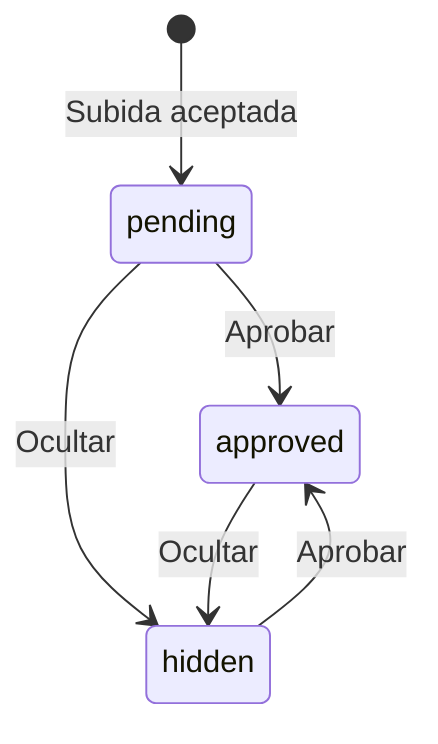

# API y almacenamiento

Referencia del servidor incluido. Todos los ejemplos son orientativos para desarrollo; usar datos de prueba. Las rutas son relativas al mismo origen que sirve `dist/`.

## Convenciones

- Respuestas JSON en UTF-8, excepto imágenes y recursos estáticos.
- POST con `Content-Type: application/json` y `Origin` cuyo dominio y puerto coincidan con `Host`.
- No hay CORS público ni autenticación de invitados mediante cuenta.
- El servidor rechaza cuerpos POST menores de 2 bytes o mayores de 12 000 000 bytes.
- Los campos de texto se recortan en los extremos, deben ser cadenas no vacías y respetar su longitud máxima.
- Las validaciones de nombres no comprueban identidad, pertenencia a la lista de boda ni asignación de pases.

## Asistencia

### POST `/api/rsvp`

```json
{
  "name": "Invitado de prueba",
  "attendance": "yes",
  "companions": 2,
  "editToken": "token-aleatorio-de-al-menos-32-caracteres"
}
```

| Campo | Reglas |
| --- | --- |
| `name` | Cadena de 1 a 80 caracteres después de quitar extremos |
| `attendance` | `yes` o `no` |
| `companions` | Entero, no booleano, entre 0 y 20; si responde no se guarda cero |
| `editToken` | Cadena de 32 a 128 caracteres |

Respuesta 200:

```json
{"reference":"KA-A1B2C3D4E5F6","companions":2}
```

El frontend genera `editToken` con dos UUID aleatorios y lo conserva en `localStorage` bajo `ka-rsvp-edit-v7`. El servidor guarda solo su SHA-256. Busca si existe una respuesta con ese hash; si existe, actualiza esa referencia, y si no, genera una referencia `KA-` más 12 caracteres hexadecimales.

No introducir el token de edición en el QR ni en WhatsApp. La referencia pública del pase es distinta del permiso de edición. La tabla no tiene una restricción UNIQUE sobre `edit_hash`, por lo que antes de aceptar concurrencia elevada conviene reforzar el modelo/transacción; la prueba cubre actualizaciones secuenciales del mismo token, no una carga simultánea masiva.

Los datos quedan en `rsvps(id, edit_hash, name, attendance, companions, updated)`. No hay endpoint público de lista ni de consulta por referencia. La respuesta del servidor confirma que se guardó; si falla el canvas después, el registro puede ya existir y un reintento desde el mismo navegador debe conservar su referencia.

## Recuerdos

### POST `/api/photos`

```json
{
  "name":"Invitada de prueba",
  "caption":"Una frase de hasta 240 caracteres.",
  "consent":true,
  "image":"BASE64_SIN_PREFIJO_DATA_URL"
}
```

- Nombre: 1–80 caracteres.
- Frase: 1–240 caracteres.
- `consent` debe ser el booleano `true`.
- `image` es el archivo completo en base64, sin `data:image/...;base64,`.
- Hasta 8 000 000 bytes de archivo y 11 000 000 caracteres de base64 en la validación específica.
- Pillow debe reconocer JPEG, PNG o WebP. Un SVG u otro contenido no pasa por aceptar una extensión.
- Pillow usa un umbral de imagen de 30 millones de píxeles; imágenes excesivas pueden rechazarse por su protección de descompresión.
- Se aplica orientación EXIF, RGB, miniatura de hasta 1800 × 1800 y guardado JPEG de calidad 85.
- Se asigna un ID aleatorio de 32 caracteres hexadecimales.

Respuesta 201:

```json
{"ok":true}
```

No devuelve un enlace público inmediato. El estado inicial es `pending` y el archivo se escribe en `.private/photos/<id>.jpg`. En SQLite se guarda `photos(id, name, caption, status, created)`. El consentimiento es obligatorio en la solicitud, pero esta versión no almacena una columna separada con texto o versión de ese consentimiento.

Frecuencia: máximo de 20 envíos aceptados por IP en una hora, contado en memoria. En un proxy, revisar cuál IP llega al servidor: el código actual usa la IP del socket, no interpreta automáticamente `X-Forwarded-For`. Un proxy que haga parecer a todos los invitados la misma IP puede agotar ese límite.

### GET `/api/photos`

Respuesta 200:

```json
{
  "photos":[
    {"id":"0123456789abcdef0123456789abcdef","name":"Invitada","caption":"Un recuerdo"}
  ]
}
```

Solo `approved`, orden por `created` descendente, límite de 150. No hay paginación pública en esta versión. La fecha no se devuelve en este endpoint.

### GET `/media/<id>.jpg`

- Si el ID existe y el estado es `approved`, entrega `image/jpeg` sin requerir sesión.
- Si está `pending` o `hidden`, requiere sesión de organizador vigente.
- ID inválido, inexistente o no autorizado: 404.
- El ID solo admite exactamente 32 caracteres hexadecimales minúsculos.

La política se comprueba en el servidor para cada lectura, no solo escondiendo tarjetas con CSS. El navegador podría conservar una copia ya vista o capturada antes de ocultar un recuerdo; ocultar no revoca copias descargadas por terceros.

## Sesión de organizadores

### POST `/api/admin/login`

```json
{"password":"CONTRASEÑA_DEL_README"}
```

Respuesta 200: `{"csrf":"token-aleatorio"}` y cookie `ka_admin` con `HttpOnly`, `SameSite=Strict`, `Path=/`, `Max-Age=28800`. Con origen HTTPS añade `Secure`.

El proceso mantiene un diccionario de sesiones y otro de intentos fallidos. La configuración de sal/hash se carga al arrancar. Un cambio en `auth.json` requiere reiniciar. El configurador `tools/configure_admin.py` escribe la misma estructura que el servidor, sin tocar SQLite ni fotos.

### GET `/api/admin/session`

Sin sesión:

```json
{"authenticated":false,"csrf":null}
```

Con sesión devuelve `authenticated: true` y el token CSRF. Esta respuesta no contiene el hash de contraseña.

### GET `/api/admin/dashboard`

Requiere cookie. Respuesta:

```json
{
  "guests":[
    {"id":"KA-A1B2C3D4E5F6","name":"Invitado","attendance":"yes","companions":2,"updated":1790000000}
  ],
  "photos":[
    {"id":"0123456789abcdef0123456789abcdef","name":"Invitada","caption":"Recuerdo","status":"pending","created":1790000000}
  ],
  "totals":{"confirmed":1,"companions":2,"people":3,"declined":0,"pending":1}
}
```

No se expone `edit_hash` en los invitados. El panel obtiene toda la lista actual; no tiene paginación de administradores.

### POST `/api/admin/moderate`

Requiere cookie y `X-CSRF-Token` con el valor de la sesión.

```json
{"id":"0123456789abcdef0123456789abcdef","status":"approved"}
```

Estados aceptados en esta operación: `approved` y `hidden`. Respuesta 200 `{"ok":true}` si actualiza una foto; 404 si no existe. Estado no permitido: 400. No se borra el archivo ni se vuelve al estado `pending` desde esta interfaz.



### POST `/api/admin/logout`

Cuerpo `{}`, cookie y CSRF. Marca la sesión como expirada en memoria y devuelve `{"ok":true}`. La cookie puede seguir presente hasta expirar, pero ya no autoriza peticiones.

## Errores

| Código | Ejemplo |
| --- | --- |
| 400 | Campos inválidos, imagen no reconocida o estado de moderación no admitido |
| 401 | Contraseña incorrecta o sesión ausente/expirada |
| 403 | Origen no permitido o CSRF inválido |
| 404 | Ruta/foto no disponible o no autorizada |
| 413 | Cuerpo POST demasiado grande |
| 415 | Tipo de contenido distinto de JSON |
| 429 | Límite de intentos de acceso o envíos de fotos |

La mayoría devuelve `{"error":"mensaje"}`. Las respuestas de archivo/404 de `SimpleHTTPRequestHandler` pueden ser HTML. El frontend de recuerdos, confirmación y panel espera JSON en las rutas de API; revisar ese contrato si se coloca un proxy que reemplace errores por páginas HTML.

## Endurecimiento pendiente para un servicio público

No hay límite de frecuencia dedicado al RSVP, cuota global de almacenamiento, trabajos automáticos de limpieza de archivos huérfanos ni auditoría de moderación. Se debe mantener o ampliar la validación en servidor, evitar servir la carpeta raíz del repositorio, configurar HTTPS y almacenamiento persistente, y acordar el nivel de acceso del panel antes de publicar. Estas son limitaciones de la entrega; no se describen como funciones ya implementadas.
