# Entrega al equipo de desarrollo

## Primer recorrido recomendado

1. Clonar o descargar este repositorio.
2. Leer los datos confirmados, alcance y contraseña en README.
3. Crear entorno virtual e instalar `requirements.txt`.
4. Ejecutar el configurador de acceso e iniciar `server.py`.
5. Abrir invitación y panel en pestañas distintas.
6. Confirmar con un nombre claramente de prueba y dos acompañantes: el panel debe reflejar 1 respuesta positiva, 2 acompañantes y total 3.
7. Reenviar una corrección desde el mismo navegador: debe conservar referencia y actualizar el registro.
8. Probar el formulario de foto con una imagen de prueba autorizada; no debe aparecer públicamente hasta aprobarla.
9. Entrar al panel, aprobar, recargar la invitación, ocultar y comprobar que deja de verse.
10. Usar un directorio de datos temporal para pruebas extensivas; no mezclarlo con la lista real de invitados.

## Diagrama de trabajo del equipo

```mermaid
flowchart LR
    A["Descargar código"] --> B["Instalar y ejecutar localmente"]
    B --> C["Rama de adecuaciones"]
    C --> D["Cambios y datos de prueba"]
    D --> E["Pruebas Python y revisión de recursos"]
    E --> F["Revisión visual móvil y escritorio"]
    F --> G["Pull request y revisión del responsable"]
    G --> H["Preparar alojamiento persistente"]
    H --> I["Prueba real desde WhatsApp"]
    I --> J["Liberación acordada con responsable"]
```



## Archivos que se deben tocar según el cambio

- Copy y secciones: `dist/index.html`.
- Apariencia general: `dist/style.css`.
- Abanico y movimiento: `dist/motion.css` y `dist/motion.js`.
- Confirmación, QR y visor: `dist/app.js`.
- Recuerdos del invitado: `dist/memories.js`.
- Panel: `dist/admin.*`.
- Reglas y persistencia: `server.py`.

No buscar un componente React, una configuración de Vite o una carpeta `src` que no existen. `dist` se mantiene directamente. Los números de versión en las consultas de CSS/JS sirven para evitar caché de revisiones; actualizarlos cuando se necesite invalidación en un despliegue.

## Criterios mínimos de revisión visual

- 390 px y 320 px de ancho, además de escritorio.
- Sin desplazamiento horizontal de toda la página.
- Rostros visibles en portada, abanico y fotos pequeñas.
- Texto completo, incluidos nombres con acentos y horarios.
- Botones alcanzables sin quedar debajo de la barra móvil fija.
- Cierre de diálogos, foco visible, Escape y navegación de fotos con teclado.
- Reducción de movimiento activada en una prueba real del navegador/sistema antes de liberar.
- No introducir reproducción automática con audio al cargar.
- El acceso al mapa debe abrir Alboreto Residencial, no un negocio homónimo.

## Pendientes funcionales que requieren decisión

### Lista nominal y acompañantes

Actualmente el número es declarado. Si se proporciona una lista de familias y pases, diseñar identificadores de invitación y validar límites en servidor. Un límite en localStorage o HTML no basta. También hay que decidir cómo tratar niños, cambios de nombre y correcciones entre dispositivos.

### Pase y QR

El QR actual abre Google Maps; la referencia impresa facilita cotejo manual. Si se busca control de acceso real, crear ruta autenticada de validación, firma o identificador verificable, política de entradas parciales por acompañante y control de reutilización. No interpretar el QR actual como un permiso de entrada seguro por sí solo.

### Panel

La contraseña documentada es conocida para cualquiera que lea el repositorio público. El responsable pidió conservarla; discutir con él una protección adicional si habrá datos reales en Internet. No cambiarla silenciosamente ni exponer bases de datos en `dist`. Revisar sesiones, intentos y CSRF si se migra a varias instancias.

### Álbum durante la boda

El límite actual por IP puede afectar a varios invitados en el mismo Wi-Fi. Revisar también la ausencia de cuota global, paginación más allá de 150 aprobadas y almacenamiento persistente. El permiso de publicación del formulario se exige, pero no se almacena una copia versionada del texto de consentimiento: decidir si se necesita ese registro.

### Publicación

No se habilitó GitHub Pages como supuesto backend. Mantener frontend y API en el mismo origen simplifica cookies y comprobación de Origin/Host. Si se elige otro modelo, adaptar esos contratos y probarlos, especialmente tras un reverse proxy.

## Guía para crear cambios

```bash
git switch -c ajustes-finales-boda
# Editar, probar y revisar.
git add README.md docs dist server.py tools requirements.txt test_server.py .github .gitignore
git diff --cached --stat
git commit -m "Ajustar invitación para revisión final"
git push -u origin ajustes-finales-boda
```

Antes de confirmar, comprobar que el área preparada no contiene `.private`, SQLite, fotos recibidas, entrevistas ni tokens. Al abrir el PR, explicar el comportamiento final, cómo se comprobó y los límites pendientes. Conservar los datos confirmados de la boda y las licencias de terceros.

## Operación local y recuperación

Si un navegador muestra que no puede acceder, revisar primero que el proceso siga activo y el puerto sea el correcto. No es prueba por sí sola de un error de autenticación.

Cambiar carpeta de trabajo o clonar en otra computadora no trae la lista de asistentes. Para migrar datos reales, hacer una copia privada controlada y coherente de SQLite/fotos/acceso; no adjuntarla al PR ni subirla a GitHub. Si se van a usar dos instancias simultáneas, no apuntarlas sin diseño previo a un archivo SQLite compartido por red.

## Qué no se hizo automáticamente

No se publicaron datos reales de invitados; no se enviaron mensajes de WhatsApp; no se registró un dominio; no se contrató hosting; no se conectó un proveedor de almacenamiento; no se decidió si la ceremonia es religiosa o civil; no se programó el borrado de recuerdos ni el cambio de contraseña tras el evento.

## Actualización V13

La película final se reserva para el evento. Las referencias históricas anteriores a la experiencia de video no describen el comportamiento actual: la portada usa fotografía animada y MP3 con inicio voluntario; ver README actualizado. Los archivos MP4 y VTT se retiraron de la carpeta pública. No introducir de nuevo enlaces al montaje final en la invitación.
